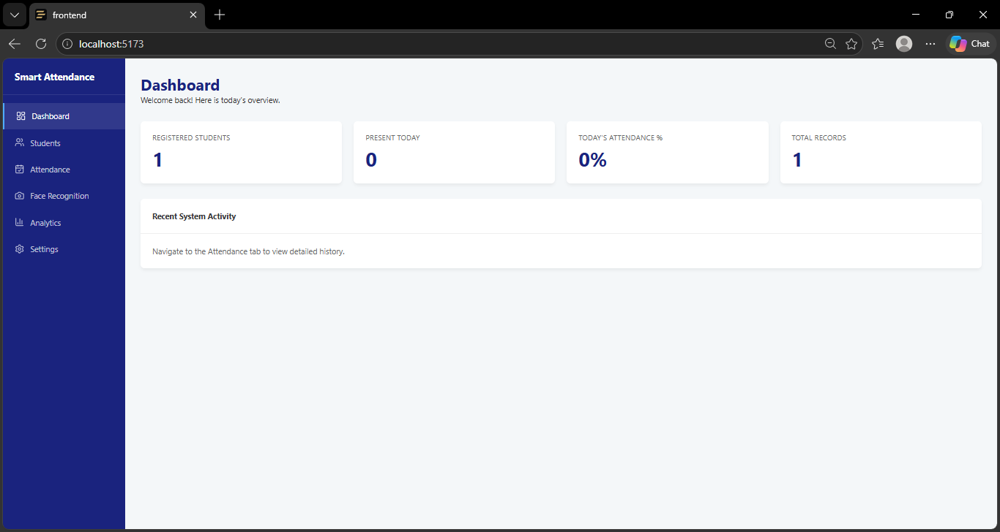
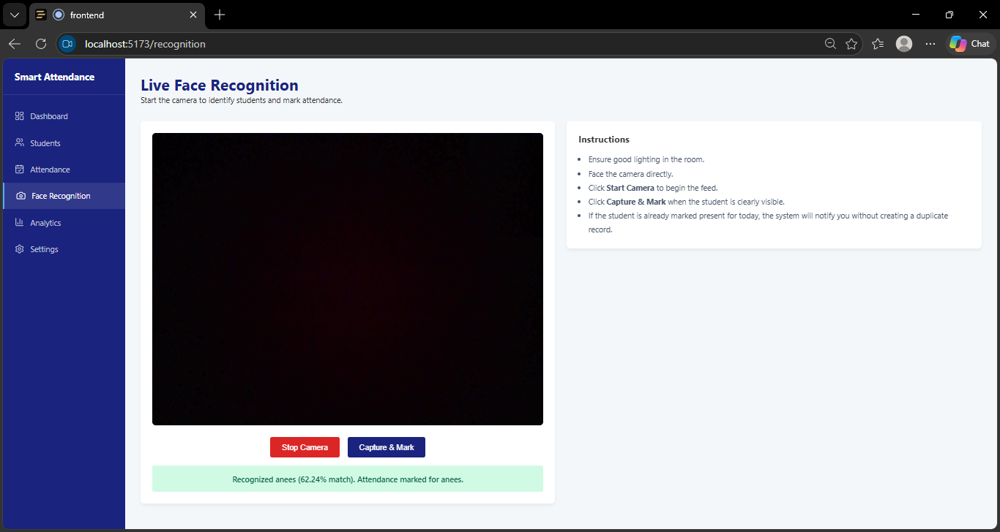
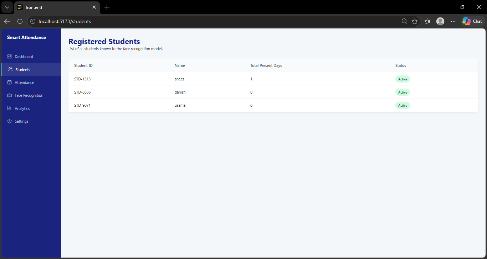
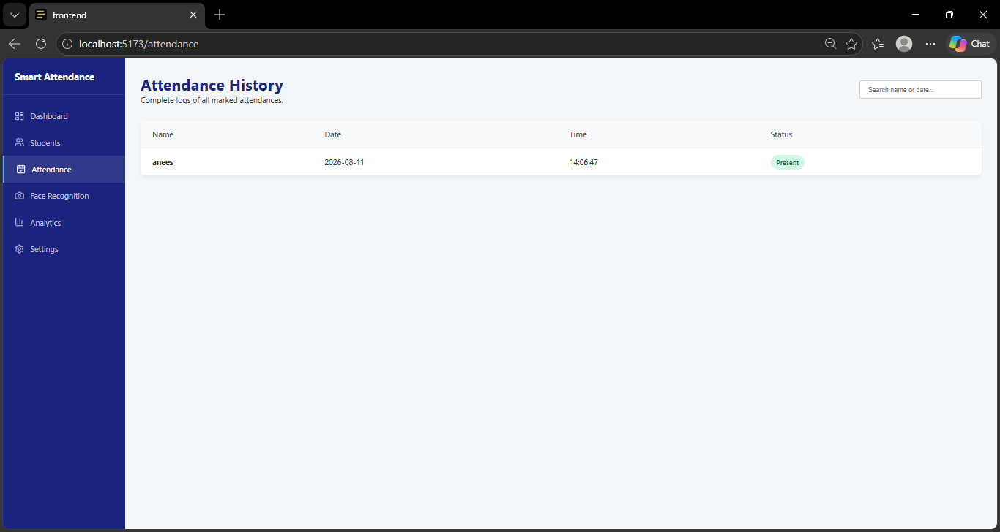

# Smart Attendance System AI

## Description
Smart Attendance System AI is an automated attendance management application that identifies registered students using computer vision face recognition. It is designed for schools, universities, and organizations to verify identity and record attendance via camera feed without manual paper registers.

## Live Demo
https://github.com/aneesofficial/Smart-Attendance-System-AI

## Tech Stack
* Python
* FastAPI
* Uvicorn
* OpenCV
* face_recognition
* NumPy
* Pandas
* React
* Vite
* JavaScript
* CSS

## Getting Started

### 1. Clone the repository
```bash
git clone https://github.com/aneesofficial/Smart-Attendance-System-AI.git
cd Smart-Attendance-System-AI
```

### 2. Install backend dependencies
```bash
cd backend
pip install -r requirements.txt
```

### 3. Install frontend dependencies
```bash
cd ../frontend
npm install
```

### 4. Run the application

Run the backend server:
```bash
cd backend
uvicorn main:app --reload --port 8000
```

Run the frontend server in a separate terminal:
```bash
cd frontend
npm run dev
```

Open http://localhost:5173 in your web browser.

## Environment Variables

Configure these keys in your environment or inside a .env file:

Frontend:
* VITE_API_URL: http://localhost:8000/api

Backend:
* FRONTEND_URL: http://localhost:5173
* MODEL_PATH: ../models/encodings.pkl
* ATTENDANCE_FILE: ../data/attendance.csv

## Screenshots








